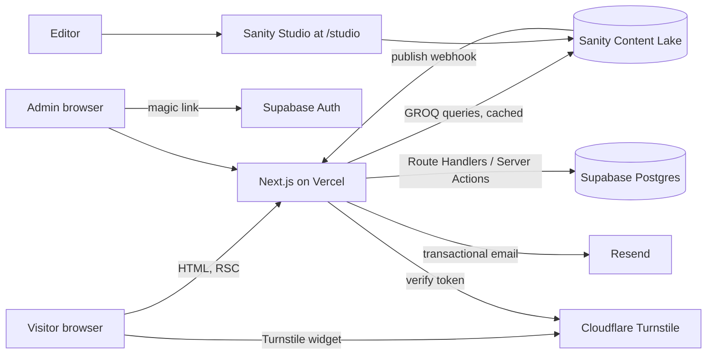

# Architecture — RoleEdge website v2

> **As built (2026-10-21):**
> - The app is in this repo and runs locally.
> - Content is in `lib/content/` (Sanity-shaped, not yet in Sanity).
> - Leads, email and admin sign-in use local stand-ins selected by `DATA_PROVIDER`, `EMAIL_PROVIDER` and `AUTH_PROVIDER`. Each refuses production.
> - The Supabase, Resend, Turnstile and Sanity steps below are still to do before launch.

> Next.js 16 specifics in use:
> - Cache Components: content functions use `"use cache"` + `cacheTag`.
> - `proxy.ts` (formerly middleware) does the optimistic admin redirect.
> - `connection()` keeps admin pages dynamic.


## 1. Overview

A server-rendered Next.js app on Vercel. Content comes from Sanity; leads and booking requests go to Supabase; emails go out through Resend. Visitors never authenticate; a small allowlisted team signs in to `/admin` with Supabase Auth magic links.



## 2. Key decisions

| Decision | Choice | Why |
| --- | --- | --- |
| Framework | Next.js App Router, TypeScript strict | Static and dynamic rendering per route, first-class on Vercel, React Server Components keep JavaScript small |
| Styling | Plain CSS: `app/site.css` (the approved v1 stylesheet) + `app/pages.css` | Keeps the approved v1 design exactly; one styling system; no CSS-in-JS runtime |
| Content | Sanity | Hosted editor for non-developers, structured content, image CDN, webhooks |
| Data | Supabase Postgres | Managed Postgres with RLS, Auth and a local dev stack |
| Writes | Route Handlers and Server Actions only | The browser never talks to Supabase directly; keys stay server-side |
| Validation | Zod schemas shared by client and server | One source of truth for form rules |
| Email | Resend + React Email templates | Simple API, good deliverability, templates in code |
| Spam | Cloudflare Turnstile | Invisible, privacy-friendly, free |
| Analytics | Vercel Web Analytics + Speed Insights | Cookieless; real Core Web Vitals |
| Package manager | npm | Already installed with Node; lockfile committed |
| Runtime | Node.js 24 LTS | Current LTS line |

Versions are pinned in `package.json` at scaffold time; use the latest stable release of each package and record it there, not in these docs.

## 3. Rendering strategy

| Route | Rendering | Revalidation |
| --- | --- | --- |
| `/`, `/services/*`, `/about`, `/stories`, `/edgeai`, `/faq`, legal pages | Static at build | On-demand by Sanity webhook (`revalidateTag`) |
| `/blog`, `/blog/[slug]`, categories | Static (`generateStaticParams`) | On-demand by tag; new slugs render on first request |
| `/start`, `/book`, `/contact` | Static shell + client components | — |
| `/book` slot data | Dynamic Route Handler | No cache (`no-store`) |
| `/admin/*` | Dynamic, server-rendered per request | No cache; auth check on every request |
| `/studio/[[...tool]]` | Client-only Sanity Studio | — |
| `/api/og` | Edge, generated Open Graph images | Cached by URL |

**Cache tags:** each Sanity fetch is tagged with its document type (`post`, `service`, `story`, `faq`, `page`, `settings`) and, for single documents, `post:<slug>`. The webhook handler maps a changed document to its tags.

**Draft preview:** Sanity Presentation tool + Next.js Draft Mode. Editors see unpublished changes on the real layout at `/api/draft-mode/enable`.

## 4. Folder structure

```
roleedge-web/
├─ app/
│  ├─ (site)/                  # public marketing routes, shared header and footer
│  │  ├─ page.tsx              # home
│  │  ├─ services/[slug]/page.tsx
│  │  ├─ blog/[slug]/page.tsx
│  │  ├─ book/page.tsx
│  │  └─ ...
│  ├─ admin/                   # team area, own layout, auth-guarded
│  │  ├─ login/page.tsx
│  │  ├─ leads/page.tsx
│  │  └─ bookings/page.tsx
│  ├─ studio/[[...tool]]/page.tsx
│  ├─ api/                     # Route Handlers, see API.md
│  ├─ auth/callback/route.ts   # Supabase magic-link callback
│  ├─ sitemap.ts, robots.ts
│  ├─ layout.tsx, not-found.tsx, error.tsx
│  └─ styles/tokens.css, globals.css
├─ components/
│  ├─ ui/                      # Button, Field, Accordion, Icon...
│  ├─ sections/                # Hero, ServiceGrid, StoryCarousel...
│  ├─ planner/, booking/, admin/
├─ lib/
│  ├─ sanity/                  # client, queries (GROQ), image helper, fetch wrapper with tags
│  ├─ supabase/                # server client, admin client, auth helpers
│  ├─ booking/                 # BookingProvider interface + MockBookingProvider
│  ├─ email/                   # Resend client + React Email templates
│  ├─ validation/              # Zod schemas
│  ├─ security/                # rate limit, Turnstile verify, request helpers
│  └─ analytics.ts
├─ sanity/
│  ├─ schemaTypes/             # post, service, story, faq, page, settings, person, category
│  ├─ structure.ts
│  └─ sanity.config.ts
├─ supabase/
│  ├─ migrations/              # SQL migrations (source of truth)
│  ├─ seed.sql
│  └─ tests/                   # pgTAP RLS tests
├─ tests/
│  ├─ unit/                    # Vitest
│  └─ e2e/                     # Playwright + axe
├─ public/
├─ proxy.ts               # refresh Supabase session for /admin only
├─ next.config.ts              # images, redirects (legacy WordPress URLs), security headers
├─ .env.example
├─ AGENTS.md
└─ README.md
```

The app lives in a new folder or repository (`roleedge-web/`). The v1 static site stays deployable until cut-over ([IMPLEMENTATION_PLAN.md](IMPLEMENTATION_PLAN.md)).

## 5. Data ownership

| Data | System of record | Notes |
| --- | --- | --- |
| Pages, services, stories, FAQs, posts, settings | Sanity | Editable by the team |
| Leads, planner email results, booking requests, admin audit log | Supabase | Personal data; RLS-protected |
| Admin identities | Supabase Auth + `admin_users` table | Allowlist |
| Images | Sanity asset CDN; static brand assets in `public/` | |
| Email delivery logs | Resend | Message ID stored on the lead |

## 6. Request flows

**Contact form submit**
1. The client validates with Zod and gets a Turnstile token.
2. `POST /api/leads` → rate-limit check → Turnstile verify → Zod parse → insert into `leads` (server-only secret key) → send emails via Resend (visitor acknowledgement + team notification).
3. If the email fails, the lead is still saved with `notification_status = 'failed'`; the error is logged.
4. The response is `201` with the lead ID; the UI shows the confirmation.

**Booking request**
1. `GET /api/booking/slots?service=…&week=…` → `MockBookingProvider.getSlots()` returns generated slots.
2. `POST /api/booking-requests` → same guard chain → `BookingProvider.createRequest()` → row in `booking_requests` → emails.

**Content publish**
1. The editor publishes in Studio.
2. The Sanity webhook calls `POST /api/revalidate` with a signed body.
3. The handler verifies the signature and calls `revalidateTag()` for the affected tags.

**Admin sign-in**
1. Email on `/admin/login` → `signInWithOtp({ shouldCreateUser: false })` (magic link). Signups are disabled, so links only go to users an owner has invited (see [SECURITY.md](SECURITY.md#2-authentication)).
2. The link lands on `/auth/callback` → session cookie → `/admin`.
3. The admin layout calls `requireAdmin()` on the server and returns `notFound()` if the user is not an active admin.

## 7. Environments

| Environment | Next.js | Supabase | Sanity dataset | Email |
| --- | --- | --- | --- | --- |
| Local | `npm run dev` | `supabase start` (Docker) | `development` | Resend test mode (`delivered@resend.dev`) |
| Preview | Vercel preview per PR | Staging project | `development` | Resend, staging sender |
| Production | Vercel production (`roleedge.com`) | Production project | `production` | Resend, verified domain |

## 8. Environment variables

| Name | Scope | Purpose |
| --- | --- | --- |
| `NEXT_PUBLIC_SITE_URL` | public | Canonical URLs, OG images |
| `NEXT_PUBLIC_SANITY_PROJECT_ID` | public | Sanity project |
| `NEXT_PUBLIC_SANITY_DATASET` | public | `production` / `development` |
| `SANITY_API_READ_TOKEN` | server | Draft preview reads |
| `SANITY_REVALIDATE_SECRET` | server | Webhook signature |
| `NEXT_PUBLIC_SUPABASE_URL` | public | Supabase project URL |
| `NEXT_PUBLIC_SUPABASE_PUBLISHABLE_KEY` | public | Auth in the browser for `/admin` login only (legacy name: anon key) |
| `SUPABASE_SECRET_KEY` | server | Server-only writes that bypass RLS (legacy name: service_role key) |
| `RESEND_API_KEY` | server | Email |
| `EMAIL_FROM`, `EMAIL_TEAM_INBOX` | server | Sender and notification recipient |
| `NEXT_PUBLIC_TURNSTILE_SITE_KEY` | public | Widget |
| `TURNSTILE_SECRET_KEY` | server | Verification |
| `BOOKING_PROVIDER` | server | `mock` (default) |

Anything without `NEXT_PUBLIC_` must never be imported into a client component. `lib/supabase/admin.ts` starts with `import "server-only"` to enforce this at build time.

## 9. Security headers (`next.config.ts`)

`Content-Security-Policy` (nonce-based; allows Sanity CDN, Turnstile, Vercel analytics), `Strict-Transport-Security`, `X-Content-Type-Options: nosniff`, `Referrer-Policy: strict-origin-when-cross-origin`, `Permissions-Policy` (camera, microphone and geolocation off), and `frame-ancestors 'none'`, except on `/studio`, which needs its own relaxed policy. Details in [SECURITY.md](SECURITY.md).

## 10. Observability

- Vercel runtime logs with a structured logger (`lib/log.ts`: JSON lines with `requestId`, `route`, `event`; no personal data in logs).
- Vercel Speed Insights for Core Web Vitals.
- Optional Sentry later; the logger wrapper keeps that swap a one-file change.
