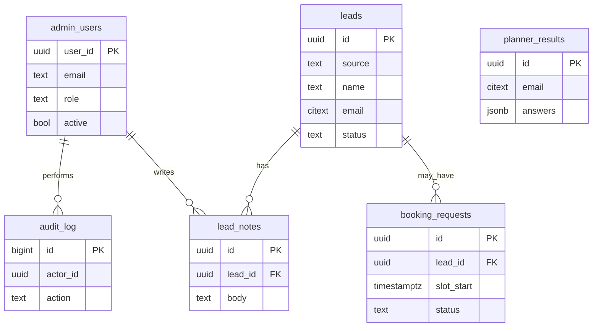

# Database — RoleEdge website v2

> **As built (2026-10-21):** `lib/data/file-store.ts` implements the same `DataStore` interface (`lib/data/types.ts`) against a local JSON file, including dedupe, rate limits, audit entries and erasure. The Supabase implementation of that interface, plus these migrations, is the pre-launch task.


Supabase Postgres stores **only operational and personal data**: leads, planner email results, booking requests, admins and the audit log. All marketing content lives in Sanity.

## 1. Principles

- **Migrations are the source of truth.** Every schema change is a SQL file in `supabase/migrations/`, created with `supabase migration new <name>`. Never change the schema through the dashboard on production.
- **RLS on every table.** No table in `public` is readable or writable by `anon`. Public writes go through server code using the secret key, after validation.
- **Admins read through RLS** using their authenticated session and the `is_admin()` function, so admin pages need no secret key.
- **Collect the minimum.** Every column holding personal data has a purpose (see §6).
- **Timestamps are `timestamptz` in UTC**; display in IST (`Asia/Kolkata`).

## 2. Entity overview



## 3. Schema

`supabase/migrations/20261020000000_init.sql`:

```sql
create extension if not exists citext;

-- Enums
create type lead_source   as enum ('contact_form', 'booking', 'planner', 'resource');
create type lead_status   as enum ('new', 'contacted', 'qualified', 'closed', 'spam');
create type lead_topic    as enum ('mba_admissions', 'consulting', 'career_change', 'resume_linkedin', 'institution', 'edgeai', 'other');
create type booking_status as enum ('requested', 'confirmed', 'declined', 'cancelled', 'completed');
create type notify_status as enum ('pending', 'sent', 'failed');

-- Admins (allowlist). Rows are inserted manually by an owner; see SECURITY.md.
create table public.admin_users (
  user_id    uuid primary key references auth.users (id) on delete cascade,
  email      citext not null unique,
  role       text not null default 'admin' check (role in ('owner', 'admin')),
  active     boolean not null default true,
  created_at timestamptz not null default now()
);

-- Leads: one row per person-intent. Booking requests and planner emails also create or attach to a lead.
create table public.leads (
  id                  uuid primary key default gen_random_uuid(),
  source              lead_source not null,
  topic               lead_topic not null default 'other',
  name                text not null check (char_length(name) between 1 and 120),
  email               citext not null check (char_length(email) <= 254),
  phone               text check (phone is null or phone ~ '^\+?[0-9 ()-]{7,20}$'),
  message             text check (message is null or char_length(message) <= 4000),
  status              lead_status not null default 'new',
  consent_at          timestamptz not null,           -- when the visitor ticked consent
  consent_text_version text not null,                 -- which privacy notice they agreed to
  utm                 jsonb not null default '{}'::jsonb, -- utm_source/medium/campaign only
  notification_status notify_status not null default 'pending',
  email_message_id    text,
  dedupe_key          text not null,                  -- sha256(lower(email)|source|topic|minute bucket)
  created_at          timestamptz not null default now(),
  updated_at          timestamptz not null default now()
);
create unique index leads_dedupe_key_idx on public.leads (dedupe_key);
create index leads_status_created_idx on public.leads (status, created_at desc);
create index leads_email_idx on public.leads (email);

create table public.lead_notes (
  id         uuid primary key default gen_random_uuid(),
  lead_id    uuid not null references public.leads (id) on delete cascade,
  author_id  uuid not null references public.admin_users (user_id),
  body       text not null check (char_length(body) between 1 and 4000),
  created_at timestamptz not null default now()
);
create index lead_notes_lead_idx on public.lead_notes (lead_id, created_at);

-- Placeholder booking: a request for a time, not a reservation.
create table public.booking_requests (
  id            uuid primary key default gen_random_uuid(),
  lead_id       uuid not null references public.leads (id) on delete cascade,
  service_slug  text not null,                        -- Sanity service slug at request time
  slot_start    timestamptz not null,
  slot_minutes  smallint not null default 30 check (slot_minutes in (15, 30, 45, 60)),
  timezone      text not null default 'Asia/Kolkata', -- visitor's display timezone
  provider      text not null default 'mock',
  provider_ref  text,                                 -- external booking ID once a real provider exists
  status        booking_status not null default 'requested',
  created_at    timestamptz not null default now(),
  updated_at    timestamptz not null default now()
);
create index booking_requests_status_slot_idx on public.booking_requests (status, slot_start);

-- Planner "email me these steps". Only created when the visitor opts in.
create table public.planner_results (
  id           uuid primary key default gen_random_uuid(),
  lead_id      uuid references public.leads (id) on delete set null,
  email        citext not null,
  answers      jsonb not null,                        -- {"goal":"consulting","stage":"...","need":"..."}
  plan_version text not null,                         -- version of the recommendation rules
  consent_at   timestamptz not null,
  created_at   timestamptz not null default now()
);

-- Append-only audit trail of admin actions.
create table public.audit_log (
  id         bigint generated always as identity primary key,
  actor_id   uuid references public.admin_users (user_id),
  action     text not null,                           -- e.g. 'lead.status_changed'
  entity     text not null,                           -- 'lead' | 'booking_request' | ...
  entity_id  uuid,
  diff       jsonb not null default '{}'::jsonb,      -- {"from":"new","to":"contacted"}
  created_at timestamptz not null default now()
);
create index audit_log_entity_idx on public.audit_log (entity, entity_id, created_at desc);

-- Simple fixed-window rate limiting for public endpoints.
create table public.rate_limits (
  key          text not null,                         -- sha256(ip|route)
  window_start timestamptz not null,
  count        integer not null default 1,
  primary key (key, window_start)
);

-- updated_at trigger
create or replace function public.touch_updated_at() returns trigger
language plpgsql as $$ begin new.updated_at = now(); return new; end $$;
create trigger leads_touch before update on public.leads
  for each row execute function public.touch_updated_at();
create trigger booking_requests_touch before update on public.booking_requests
  for each row execute function public.touch_updated_at();
```

## 4. Row Level Security

`supabase/migrations/20261020000100_rls.sql`:

```sql
-- Helper: is the current user an active admin?
create or replace function public.is_admin() returns boolean
language sql stable security definer set search_path = public as $$
  select exists (
    select 1 from public.admin_users
    where user_id = auth.uid() and active
  );
$$;
revoke all on function public.is_admin() from public;
grant execute on function public.is_admin() to authenticated;

alter table public.admin_users      enable row level security;
alter table public.leads            enable row level security;
alter table public.lead_notes       enable row level security;
alter table public.booking_requests enable row level security;
alter table public.planner_results  enable row level security;
alter table public.audit_log        enable row level security;
alter table public.rate_limits      enable row level security;

-- anon: no policies anywhere, so no access. Public inserts use the secret key on the server.

-- Admins can read and triage
create policy "admins read leads"   on public.leads for select to authenticated using (public.is_admin());
create policy "admins update leads" on public.leads for update to authenticated
  using (public.is_admin()) with check (public.is_admin());

create policy "admins read notes"   on public.lead_notes for select to authenticated using (public.is_admin());
create policy "admins add notes"    on public.lead_notes for insert to authenticated
  with check (public.is_admin() and author_id = auth.uid());

create policy "admins read bookings"   on public.booking_requests for select to authenticated using (public.is_admin());
create policy "admins update bookings" on public.booking_requests for update to authenticated
  using (public.is_admin()) with check (public.is_admin());

create policy "admins read planner" on public.planner_results for select to authenticated using (public.is_admin());

create policy "admins read audit"   on public.audit_log for select to authenticated using (public.is_admin());
create policy "admins see self"     on public.admin_users for select to authenticated using (user_id = auth.uid());

-- Column-level guard: admins may only change status-like columns on leads
revoke update on public.leads from authenticated;
grant update (status) on public.leads to authenticated;
revoke update on public.booking_requests from authenticated;
grant update (status) on public.booking_requests to authenticated;

-- audit_log, rate_limits and admin_users are written only by the server (secret key) or by triggers.
```

**Audit trigger:** a `security definer` trigger on `leads` and `booking_requests` writes `audit_log` rows when `status` changes, with `actor_id = auth.uid()`. Writing the audit row in the database, not the app, means it cannot be skipped.

**RLS tests** in `supabase/tests/rls.test.sql` (pgTAP) must prove that:
- `anon` cannot select or insert on any table;
- an authenticated non-admin sees zero rows;
- an admin can update `status` but not `email` on `leads`;
- `audit_log` gets a row on every status change.

## 5. Rate limiting function

```sql
create or replace function public.hit_rate_limit(p_key text, p_window_seconds int, p_max int)
returns boolean language plpgsql security definer set search_path = public as $$
declare
  w timestamptz := to_timestamp(floor(extract(epoch from now()) / p_window_seconds) * p_window_seconds);
  c int;
begin
  insert into rate_limits (key, window_start) values (p_key, w)
  on conflict (key, window_start) do update set count = rate_limits.count + 1
  returning count into c;
  return c <= p_max;  -- true = allowed
end $$;
revoke all on function public.hit_rate_limit(text, int, int) from public, anon, authenticated;
```

It is called only from the server with the secret key. A scheduled job deletes `rate_limits` rows older than one day.

## 6. Personal data and retention

| Table | Personal data | Purpose | Retention |
| --- | --- | --- | --- |
| `leads` | name, email, phone, message | Respond to the enquiry | 24 months after last update, then deleted. `spam` rows are deleted after 30 days. |
| `booking_requests` | linked lead, chosen time | Arrange the call | Same as the parent lead |
| `planner_results` | email, answers | Send the requested plan | 12 months |
| `lead_notes` | free text by admins | Follow-up context | Same as the parent lead |
| `audit_log` | admin IDs | Accountability | 36 months |
| `rate_limits` | hashed IP | Abuse prevention | 1 day |

Retention runs as a `pg_cron` job (`supabase/migrations/..._retention.sql`) every night at 02:00 IST. **Deletion on request** (DPDP Act right to erasure): an owner deletes the lead from `/admin/leads/[id]` ("Delete all data for this person"), which cascades to notes, booking requests and planner results and writes an `audit_log` row containing no personal data.

Raw IP addresses are never stored; only `sha256(ip + daily salt)` is kept, for rate limiting.

## 7. Types

Run `npm run db:types` (`supabase gen types typescript --local > lib/supabase/database.types.ts`) after every migration and commit the result. Code imports `Database` types from there; never hand-write row types.

## 8. Seed data

`supabase/seed.sql` creates fake leads (`@example.com` addresses only), booking requests across all statuses, and one admin user for local development (`admin@example.com`). The seed must never contain real people.

## 9. Backups

Production uses Supabase daily backups (point-in-time recovery if the plan allows). Before any destructive migration, take a manual backup and note it in the PR.
